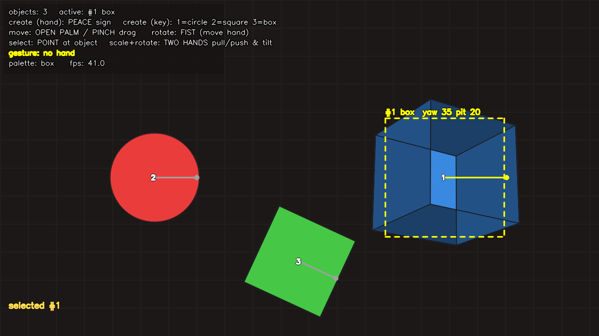

# Hand Object Studio

Create and manipulate **box / square / circle** objects in front of your webcam using
**hand gestures**, or by **typing** a command. Objects can be moved, rotated (turned),
scaled and deleted with your bare hands.

```
python main.py
```

 *(generated with: `python main.py --source docs/_canvas.png --command "add box 110 blue" --command "rotate y 35" ... --snapshot docs/demo.png`)*

---

## 1. Quick start

```bash
cd hand-object-studio

# one-shot helper (creates .venv, installs deps, launches the app)
./run.sh

# ...or manually
python3 -m venv .venv
source .venv/bin/activate          # Windows: .venv\Scripts\activate
pip install -r requirements.txt
python main.py
```

Tested with **Python 3.9 - 3.11**, `mediapipe==0.10.21`, `opencv-python==4.11`.

| Situation | Command |
|---|---|
| Default webcam | `python main.py` |
| Second camera | `python main.py --camera 1` |
| Video file | `python main.py --source clip.mp4` |
| No camera / server | `python main.py --source frame.png --no-display --max-frames 30 --snapshot out.png` |
| Start with objects already placed | `python main.py --command "add circle 120 red" --command "add box 100 blue"` |
| Load a saved scene | `python main.py --load scene.json` |
| Record the session | `python main.py --record session.mp4` |

Press **`h`** inside the app for the built-in help overlay.

---

## 2. Hand gesture guide (the "hand signals")

Hold your hand so the whole hand is visible, ~40-80 cm from the camera.

| Gesture | What it looks like | What it does |
|---|---|---|
| ✌️ **PEACE** (index + middle up, ring/pinky down) | like a V sign | **CREATE** a new object of the current palette kind at your hand |
| 🤏 **PINCH** (thumb touches index) | holding a coin | **GRAB & DRAG** - the nearest/active object follows your pinch point |
| ✋ **OPEN PALM** (all fingers up) | stop sign | **MOVE** the active object (push it while your palm is near it) |
| ✊ **FIST** | closed hand | **TURN / ROTATE** - move the fist left/right to yaw, up/down to pitch |
| ☝️ **POINT** (index only) | pointing | **SELECT** - keep the fingertip on an object for ~0.4 s to select it |
| 🤲 **TWO HANDS** (open palms, both visible) | holding a big box | **SCALE** (pull hands apart / push together) and **ROTATE** (tilt the line between hands) |

Notes
- With only one object in the scene it is always the *active* object - every gesture applies to it.
- The **active** object is drawn with a yellow dashed frame + label `#id kind`.
- The PEACE create gesture is **debounced**: you must lower the hand (change pose) before it fires again.
- A small line with a dot marks each object's rotation angle (so you can see a circle rotate).

### Keyboard (works at any time, no typing mode needed)

| Key | Action |
|---|---|
| `1` / `2` / `3` | create **circle** / **square** / **box** |
| `Tab` or `p` | cycle the palette (what the PEACE gesture creates) |
| `[` / `]` | rotate active object -15° / +15° |
| `-` / `+` | scale active object down / up |
| arrow keys | nudge the active object |
| `x` / `Backspace` | delete the active object |
| `s` | save scene to `scene.json` |
| `t` | enter **typing mode** |
| `h` | toggle help overlay |
| `q` / `Esc` | quit |

---

## 3. Typed commands (the "type to get the object" option)

Press **`t`**, type a command, press **Enter** (`Esc` cancels, `Backspace` deletes a char).
Commands can also be given at launch: `--command "add circle 120 red"` (repeatable).

| Command | Effect |
|---|---|
| `add circle` \| `add square` \| `add box` | create that shape (aliases: `cube`→box, `rectangle`→square) |
| `circle 120 red` | shorthand: kind + size + colour in one line |
| `add box 90 #3366ff` | size in pixels, colour as name or hex |
| `select 3` / `select nearest` | change the active object |
| `list` | print all objects |
| `move 40 -20` | move the active object by dx,dy |
| `goto 640 360` | place the active object at x,y |
| `rotate 45` | in-plane rotation (circle/square) |
| `rotate y 30` / `rotate x 30` | yaw / pitch - only meaningful for `box` |
| `scale 1.5` or `scale 150%` | resize the active object |
| `color red` / `color #ff8000` | recolour the active object |
| `delete 2` / `delete` | remove object by id (or the active one) |
| `clear` | remove everything |
| `save [file]` / `load <file>` | persist / restore the scene as JSON |
| `palette circle` | set what the PEACE gesture creates |
| `help` | show the command list |

Colours: `red green blue cyan magenta yellow orange white purple pink` or `#rrggbb`.

---

## 4. How it works (architecture)

```
 webcam / video / image
        │
        ▼
 OpenCV  ──►  mirrored BGR frame
        │
        ▼
 MediaPipe Hands (pre-trained CNN, runs locally)  ──  app/hand_tracker.py
        │  21 landmarks x 3 per hand, handedness score
        ▼
 Gesture classifier                              ──  app/gestures.py
        │  pinch / palm / fist / point / peace  (+ 2-hand distance & angle)
        ▼
 Interaction controller                          ──  app/controller.py
        │  debounce, dwell-select, drag, rotate-by-delta, scale-by-ratio
        ▼
 Scene model (objects, ids, selection, JSON)     ──  app/scene.py, app/objects.py
        │
        ├── typed command parser                 ──  app/commands.py
        │
        ▼
 Renderer (grid, shaded 3D box, HUD, help)       ──  app/renderer.py
        │
        ▼
 cv2.imshow window  (+ optional mp4 recording / PNG snapshot)
```

| File | Responsibility |
|---|---|
| `main.py` | CLI, capture loop, keyboard, HUD wiring, recording/snapshot |
| `app/hand_tracker.py` | MediaPipe wrapper, landmark → pixel conversion |
| `app/gestures.py` | landmark geometry → gesture label, two-hand state |
| `app/controller.py` | gesture → scene mutation (create/move/rotate/scale/select) |
| `app/objects.py` | `Shape` data, colour parsing, cube vertices + projection |
| `app/scene.py` | object registry, selection, save/load |
| `app/commands.py` | typed command grammar |
| `app/renderer.py` | drawing: shapes, shaded box, selection frame, HUD |
| `tests/test_all.py` | unit + headless integration tests |
| `training/train_hand_detector.py` | optional: train your own detector |

### The 3D box
`box` is a real wireframe/solid cube: 8 vertices are rotated (in-plane angle, yaw, pitch),
perspective-projected (`scale = f / (f - z)`), the 6 faces are depth-sorted (painter's
algorithm) and shaded with a fixed light direction - so when you turn it with a **fist**
or **two-hand tilt** you see proper 3D.

### Interaction details you may want to tweak
- `app/gestures.py` → `classify()`: pinch threshold `0.40` (vs hand size), finger "extended" test.
- `app/controller.py`: point-select dwell `0.35 s`, palm drag radius `radius+70`,
  per-frame two-hand scale clamp `0.92..1.08`, fist rotation gain `0.55°/px`.

---

## 5. Training / teaching it your own hands

The default model ships with MediaPipe (pre-trained on millions of hands) - **you do not
need to train anything** to use this project. Train only if you need better accuracy for
your lighting/camera, or want to detect hands MediaPipe misses.

### Route A - MediaPipe (easiest, fine-tune)
1. Record 300-1000 images of your hands (different lighting, distances, backgrounds).
2. Label them with the 21 landmarks using MediaPipe's data: https://mediapihe.github.io/ or any hand-landmark tool (e.g. `labelme` + converters).
3. Fine-tune with **MediaPipe Model Maker** (hand landmarker task):
   ```bash
   pip install mediapipe-model-maker
   # follow: https://ai.google.dev/edge/mediapipe/solutions/vision/hand_landmarker/tasks_api
   ```
4. Point the app at it: replace `mp.solutions.hands.Hands(...)` in `app/hand_tracker.py`
   with the `mediapipe.tasks.python.vision.HandLandmarker` API (same landmark output).

### Route B - YOLOv8 detector (most robust, recommended for odd angles)
```bash
pip install ultralytics
# your dataset must be YOLO format:
#   dataset/images/train  dataset/images/val
#   dataset/labels/train  dataset/labels/val   (class cx cy w h, normalised)
#   dataset/data.yaml ->  path, train, val, names: {0: hand}
python training/train_hand_detector.py --data dataset/data.yaml --epochs 50
# weights: runs/hand/weights/best.pt
```
No dataset? Convert **HaGRID** (100k+ hand images, https://github.com/hukenovs/hagrid):
```bash
python training/train_hand_detector.py --hagrid /path/to/HaGRID --data dataset/hand.yaml --epochs 50
```
Other good datasets: **HaGRID**, **OneHand10K**, **FreiHAND**, **COCO-WholeBody**,
**Roboflow Universe → "hand detection"** collections.

To use the trained detector in the app, swap `HandTracker.process()` for an Ultralytics
inference call and rebuild 21 landmarks from the box + keypoints (or keep MediaPipe for
landmarks and use YOLO only for detection - the controller needs `HandPose` objects).

### Route C - teach the *gestures*, not the detector
All gesture logic is one function: `app/gestures.py: classify()`. If your hand yields a
wrong label, tune the threshold, or collect `(21,2) -> gesture` samples and train a tiny
scikit-learn/logistic-regression classifier - the input format is already the
`HandPose.points` array.

---

## 6. Testing

```bash
python tests/test_all.py          # 7 tests: gestures, scene, commands, renderer, controller, tracker, headless app
# or
pytest tests/
```
The suite needs **no camera** and covers the full pipeline (including launching `main.py`
on an image and writing a snapshot).

---

## 7. Troubleshooting

| Problem | Fix |
|---|---|
| `could not open camera 0` | close Zoom/Browser using it, try `--camera 1`, check `ls /dev/video*` (Linux) |
| No window opens | you are headless - use `--no-display --max-frames N --snapshot out.png`, or X11/VNC forwarding |
| Hand not detected | better light, plain background, palm fully in frame, move closer, lower threshold: `HandTracker(detection_confidence=0.4, ...)` |
| Jittery movement | raise `tracking_confidence`, or lower the fist/palm gain in `app/controller.py` |
| Gestures trigger wrongly | adjust `classify()` thresholds in `app/gestures.py` |
| Wrong handedness label | MediaPipe assumes a mirrored selfie view; the app mirrors by default - use `--no-mirror` only if your camera is not mirrored |
| Slow FPS | use `HandTracker(model_complexity=0, ...)` and a smaller `--width/--height` |
| `ImportError / segfault` on import mediapipe | use the pinned versions in `requirements.txt` in a **fresh venv** (global conda/tensorflow protobuf clashes are common) |
| Typing mode keys not registering | click the video window first so it has keyboard focus |

---

## 8. Ideas to extend
- Add new shapes (`triangle`, `star`, text) - add the kind to `KINDS`, a `_draw_*` function in `renderer.py`, done.
- Voice commands: feed a transcript into `app/commands.run_command()`.
- Two-hand **twist** to spin a box on all three axes; pinch-with-two-hands to rotate.
- Export the scene to SVG/OBJ for 3D printing.
